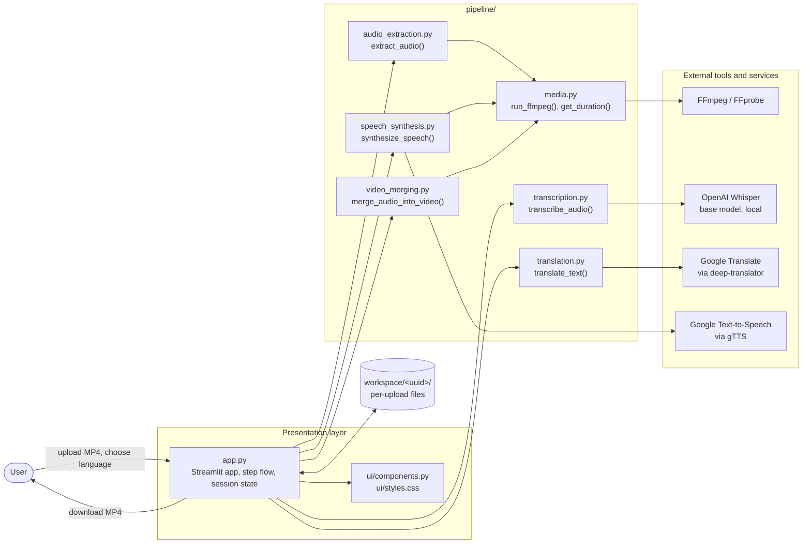
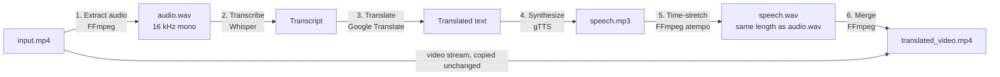

# Multilingual Video Translation System

A Streamlit application that translates the spoken language of a video into another language. It transcribes the original speech, translates it, generates new speech, fits that speech to the original duration, and replaces the video's soundtrack.

Supported target languages: Hindi, French, Spanish, German, Tamil. The source language is detected automatically.

## Architecture



### Processing pipeline



| Step | Module | What it does |
|---|---|---|
| Upload | `app.py` | Saves the MP4 to a new `workspace/<uuid>/` folder so separate runs never overwrite each other. |
| Extract audio | `pipeline/audio_extraction.py` | Converts the soundtrack to a 16 kHz mono WAV, the format Whisper expects. |
| Transcribe | `pipeline/transcription.py` | Runs the Whisper `base` model locally and returns the transcript. |
| Translate | `pipeline/translation.py` | Translates with Google Translate (source auto-detected). Text is split into 4,500-character chunks to stay under the service's 5,000-character limit. |
| Synthesize | `pipeline/speech_synthesis.py` | Generates speech with gTTS, then speeds it up or slows it down with FFmpeg's `atempo` filter so it matches the original audio length. Filters are chained for factors outside atempo's 0.5 to 2.0 range. |
| Merge | `pipeline/video_merging.py` | Replaces the audio track with the new speech (AAC), copying the video stream without re-encoding. |

The UI runs these as six gated steps: each step's button appears only after the previous step finishes, and its output (audio, transcript, translation, speech, final video) is shown for review before continuing.

## Tech stack

| Component | Technology |
|---|---|
| Language | Python |
| Web interface | Streamlit |
| Speech recognition | OpenAI Whisper (`base` model) |
| Translation | Google Translate via `deep-translator` |
| Speech synthesis | gTTS |
| Audio and video processing | FFmpeg, FFprobe |

## Getting started

### Prerequisites

- Python 3.9 or newer
- FFmpeg (includes FFprobe) available on the system `PATH`
- Internet access for translation and speech synthesis, and to download the Whisper model (about 140 MB) on first use

Install FFmpeg:

| OS | Command |
|---|---|
| Windows | Download from [ffmpeg.org](https://ffmpeg.org/download.html) and add the `bin` folder to `PATH` |
| macOS | `brew install ffmpeg` |
| Debian / Ubuntu | `sudo apt install ffmpeg` |

Check the installation with `ffmpeg -version`.

### Installation

```bash
git clone https://github.com/Mona-Agrawall/multilingual-video-translation-system.git
cd multilingual-video-translation-system
pip install -r requirements.txt
```

### Run

```bash
streamlit run app.py
```

Open `http://localhost:8501`, upload an MP4 (up to 200 MB), and follow the steps. The final video can be downloaded from the last step.

### GitHub Codespaces

The repository includes a dev container (`.devcontainer/`, Python 3.11). Opening it in Codespaces installs FFmpeg from `packages.txt` and the Python dependencies, then starts the app on port 8501.

## Project structure

```
.
├── app.py                    Streamlit entry point: layout, step flow, session state
├── pipeline/                 Translation pipeline, one module per step
│   ├── audio_extraction.py   Video to 16 kHz mono WAV
│   ├── transcription.py      Speech to text (Whisper)
│   ├── translation.py        Text to target language (Google Translate)
│   ├── speech_synthesis.py   Text to speech, duration-matched (gTTS, FFmpeg)
│   ├── video_merging.py      New audio and original video to MP4 (FFmpeg)
│   └── media.py              Shared FFmpeg and FFprobe helpers
├── ui/
│   ├── components.py         HTML components (navbar, step cards, progress tracker)
│   └── styles.css            Page styling
├── requirements.txt          Python dependencies
├── packages.txt              System packages for Streamlit Cloud and Codespaces (FFmpeg)
└── .devcontainer/            GitHub Codespaces configuration
```

At runtime the app creates `workspace/<uuid>/` for each upload (ignored by git):

| File | Contents |
|---|---|
| `input.mp4` | Uploaded video |
| `audio.wav` | Extracted audio |
| `speech.mp3` | Raw gTTS output |
| `speech.wav` | Speech stretched to the original duration |
| `translated_video.mp4` | Final output |

Workspace folders are not deleted automatically.

## Adding a language

Add an entry to the `LANGUAGES` dictionary in `app.py`. The code must be supported by both Google Translate and gTTS:

```python
LANGUAGES = {
    ...
    "Japanese": "ja",
}
```

## Limitations

- Timing is matched for the whole clip, not per sentence. The translated speech starts and ends with the original audio, but individual sentences do not line up with on-screen lip movement.
- The output uses a single synthetic gTTS voice; the original speaker's voice, background music and sound effects are replaced.
- Large differences in speech length produce noticeably fast or slow audio.
- Only MP4 input is accepted.

## Author

Mona Agrawal - [GitHub](https://github.com/Mona-Agrawall) · [LinkedIn](https://www.linkedin.com/in/mona-agrawal-/)
